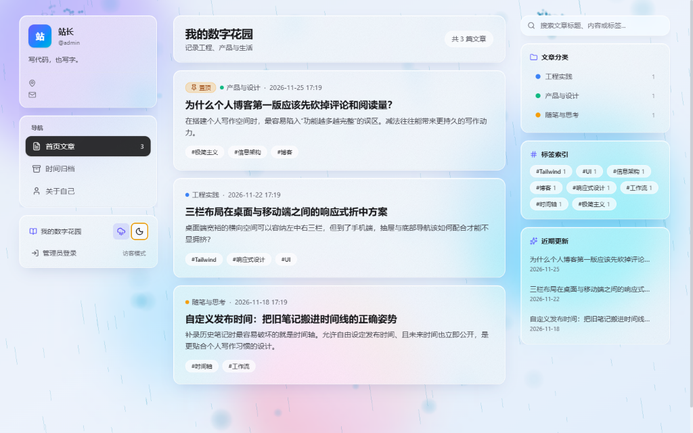
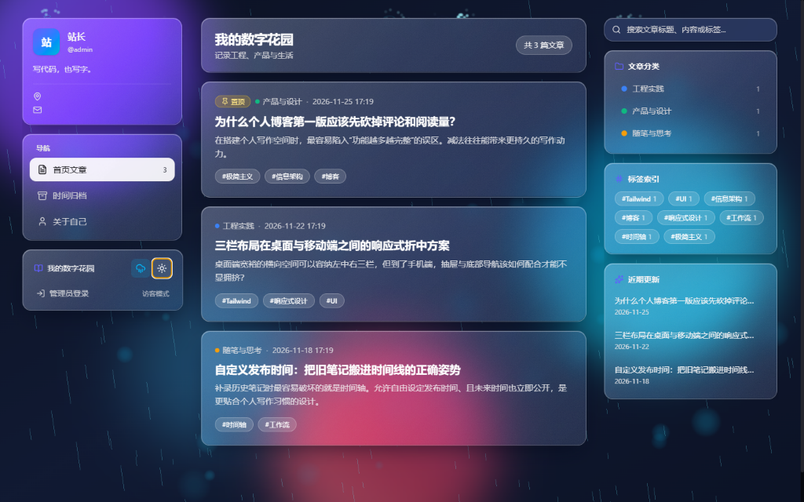
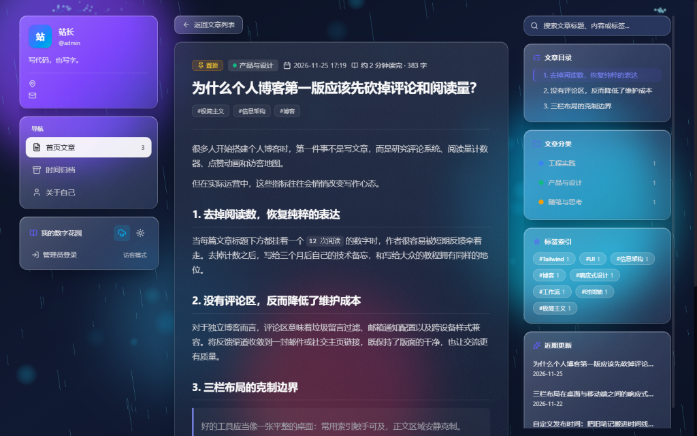

# 我的数字花园 · 个人博客与私有日报

一个兼具**公开极简博客（含个人简历）**与**仅管理员可见的每日日报空间**的个人数字花园。  
桌面端三栏磨砂玻璃（Glassmorphism）布局，支持浅色 / 暗色主题与可开关的 Three.js 3D 雨景氛围；移动端自适应收起为抽屉 + 底部固定导航。

- **公开侧**：文章流、单篇沉浸阅读（含阅读进度条与右侧实时目录 TOC）、年月时间归档、关于自己 / 个人简历。
- **私有侧**：每日日报（三段式模板 / 自由随笔、心情状态、标签、支持补写任意历史日期）、管理后台（双栏 Markdown 编辑与实时预览、Ctrl+V 粘贴 / 拖拽自动上传图片、分类与标签管理、博客头像与站点设置、密码修改）。
- **公私严格隔离**：未登录时前端不展示任何日记与后台入口，**后端接口层面对日记 / 草稿 / 后台与上传请求一律返回 401**。

## 界面预览

### 浅色模式 · 三栏磨砂玻璃首页


### 暗色模式 · Three.js 3D 雨景氛围


### 沉浸阅读 · 右侧实时目录


## 技术栈

| 层 | 选型 |
|---|---|
| 前端 | React 19 + TypeScript + Vite 6 + Tailwind CSS v4 + Three.js + DOMPurify |
| 后端 | Python 3.12 · FastAPI · Uvicorn · SQLAlchemy 2.0 (async) · aiomysql · Alembic |
| 数据库 | MySQL 8.0（独立业务库 `personal_blog` + 最小权限账号 `blog_app`） |
| 部署 | Docker Compose：Nginx（静态资源 + `/api` 反代 + `/uploads` 图片托管） + FastAPI + MySQL 8.0 |

## 目录结构

```text
blog-gemini/
├── docs/
│   ├── DEVELOPMENT_SPEC.md     # 开发文档（产品边界 / 数据库 / 接口 / 约束）
│   ├── API_CONTRACT.md         # 前后端对齐的 API 契约（字段命名、状态码、返回结构）
│   └── screenshots/            # README 界面预览截图
├── src/                        # 前端源码（api/ 组件 / 工具）
├── backend/                    # 后端源码（app/ alembic/ tests/ Dockerfile）
├── deploy/                     # nginx.conf · Dockerfile.web · compose.yaml · .env.example
├── scripts/
│   ├── dev.ps1                 # 本地一键启动（迁移 + 后端 8005 + 前端 5173）
│   ├── smoke_test.py           # 端到端验收脚本
│   └── local_demo_data.py      # 写入示例文章与日记数据
├── index.html · package.json · vite.config.ts · tsconfig.json
└── .gitignore · .dockerignore · .gitattributes
```

## 本地开发

### 前置依赖

- Node.js 20+
- Python 3.12+
- MySQL 8.0

### 1. 创建数据库与账号（一次性）

```sql
CREATE DATABASE IF NOT EXISTS `personal_blog`
  CHARACTER SET utf8mb4 COLLATE utf8mb4_unicode_ci;
CREATE DATABASE IF NOT EXISTS `personal_blog_test`
  CHARACTER SET utf8mb4 COLLATE utf8mb4_unicode_ci;
CREATE USER IF NOT EXISTS 'blog_app'@'localhost' IDENTIFIED BY '<强随机密码>';
GRANT ALL PRIVILEGES ON `personal_blog`.* TO 'blog_app'@'localhost';
GRANT ALL PRIVILEGES ON `personal_blog_test`.* TO 'blog_app'@'localhost';
FLUSH PRIVILEGES;
```

> 建议仅向 `blog_app` 授予上述两个库的权限，避免影响同实例上的其它业务库。

### 2. 配置后端环境变量

```powershell
copy backend\.env.example backend\.env
# 按注释填入 DATABASE_URL / JWT_SECRET / ADMIN_INIT_PASSWORD / TEST_DATABASE_URL
```

### 3. 一键启动

```powershell
pwsh -File scripts\dev.ps1
```

脚本会自动创建虚拟环境、安装依赖、执行 `alembic upgrade head` 与 `python -m app.seed`，并启动后端 `127.0.0.1:8005` 与前端 `127.0.0.1:5173`。

| 地址 | 用途 |
|---|---|
| http://127.0.0.1:5173 | 博客前端（Vite 已将 `/api`、`/health`、`/uploads` 代理至 8005） |
| http://127.0.0.1:8005/health | 健康检查（含真实 `SELECT 1`） |
| http://127.0.0.1:8005/api/docs | 后端 OpenAPI / Swagger 文档 |

**管理员登录**：点击左侧栏底部「管理员登录」，初始密码为 `backend/.env` 中配置的 `ADMIN_INIT_PASSWORD`。

如需快速灌入示例内容预览界面：

```powershell
python scripts\local_demo_data.py
```

### 4. 测试与构建

```powershell
# 后端单元 / 集成测试（需在 backend/.env 中配置 TEST_DATABASE_URL）
cd backend
.\.venv\Scripts\python.exe -m pytest -q

# 前端类型检查与生产构建
npm run build
```

## 功能边界（第一版设计约束）

不做文章评论 / 留言板、不做点赞收藏、**不做浏览量统计**、不做右侧发布日历微件、不做定时发布隐藏逻辑（未来发布时间仅作展示与排序时间，状态为 `published` 即对访客公开）。

## Docker Compose 构建运行

1. 提前准备好 MySQL 8.0 数据库与最小权限账号；
2. 复制环境变量模板并填入真实配置：

   ```bash
   cp deploy/.env.example deploy/.env
   chmod 600 deploy/.env
   ```

3. 构建并启动容器（容器启动时会自动执行 `alembic upgrade head` 与幂等初始化）：

   ```bash
   cd deploy
   docker compose up -d --build
   ```

## 安全要点

- 所有密钥（数据库密码、JWT Secret、初始管理员密码）仅通过环境变量注入；`.env` 已在 `.gitignore` / `.dockerignore` 中排除。
- 管理员会话使用 `HttpOnly; SameSite=Lax` 签名 Cookie（HTTPS 环境下需设置 `COOKIE_SECURE=true`）；改密后 `token_version` 递增，旧会话立即失效。
- 登录接口按客户端 IP 限流（1 分钟内最多 10 次失败尝试）。
- 图片上传校验真实文件魔数（PNG / JPEG / WebP / GIF）并限制大小，拒绝伪装或 SVG 脚本文件。
- Markdown 渲染统一经过 `DOMPurify.sanitize`，正文与个人简历均防范 XSS。
- 公开接口永不返回草稿、日记或任何密码字段。
